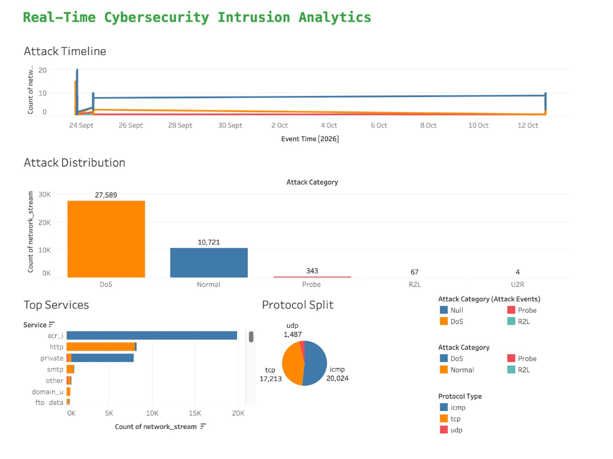
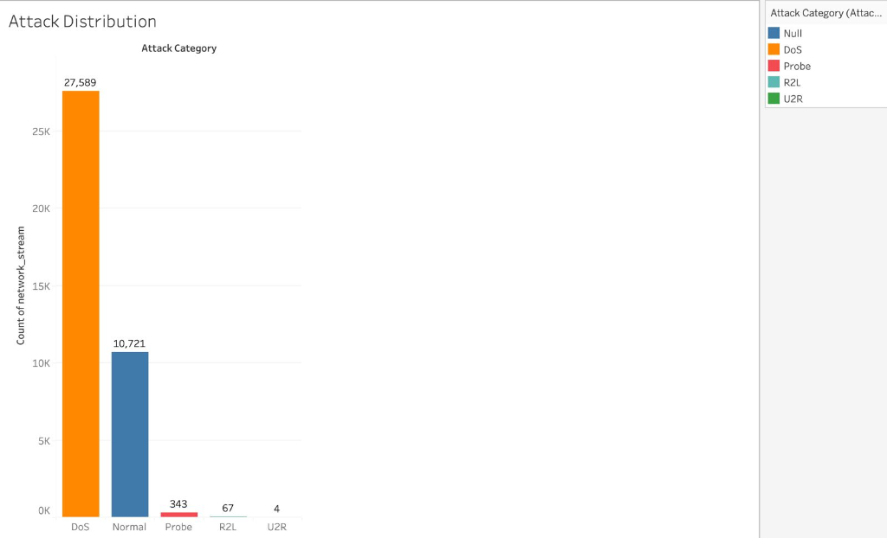
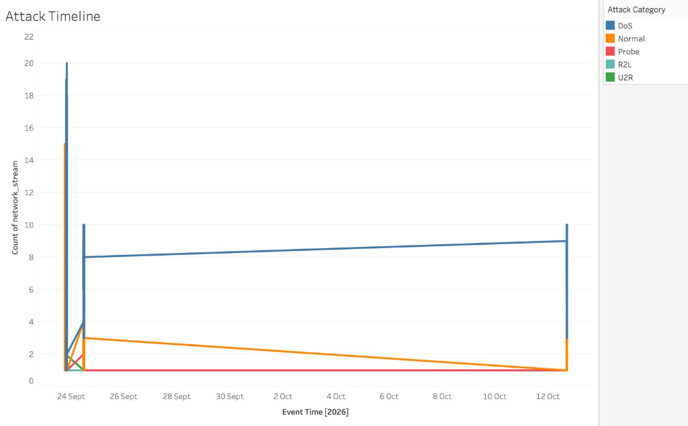
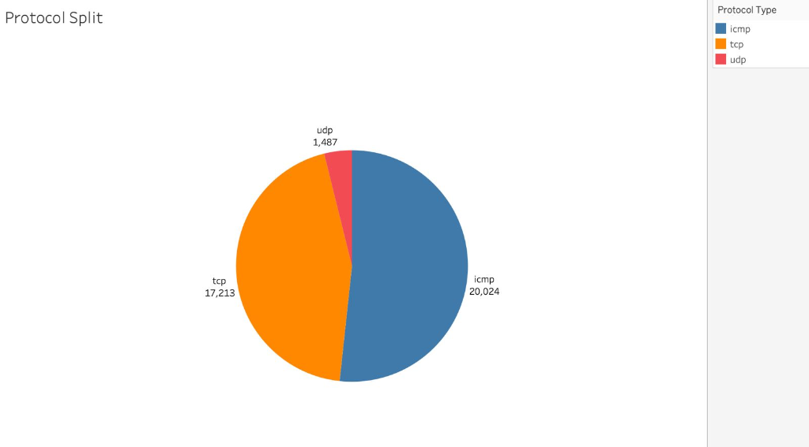
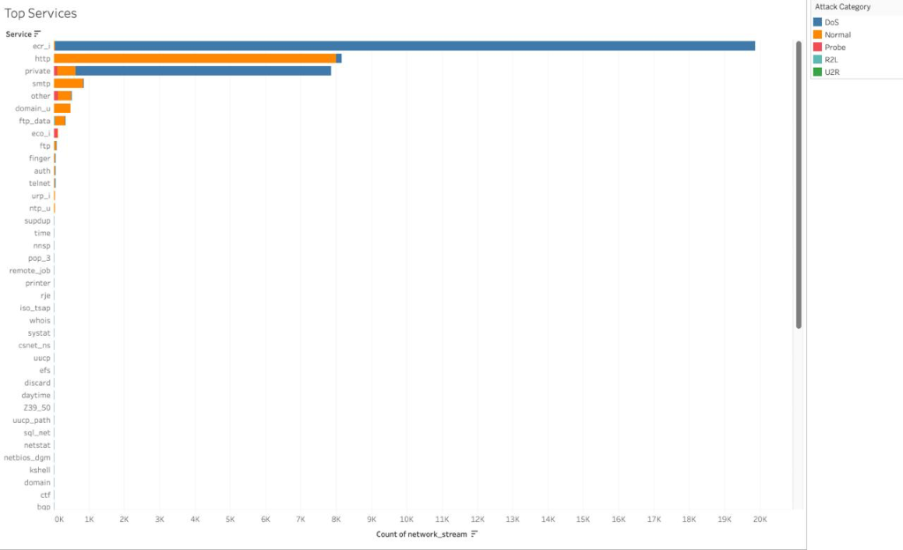

# 🛡️ Kafka Cybersecurity Intrusion Detector

[](https://python.org)
[](https://kafka.apache.org)
[](https://fastapi.tiangolo.com)
[](https://react.dev)
[](https://postgresql.org)
[](https://tableau.com)
[](https://scikit-learn.org)

An enterprise-grade, end-to-end **Real-Time Network Intrusion Detection System (NIDS)** and cybersecurity intelligence platform. Continuous network telemetry streams through **Apache Kafka**, undergoes real-time inference via a **hybrid Machine Learning engine** (supervised **Random Forest Classifier** + unsupervised **Isolation Forest Anomaly Detector**), persists into **PostgreSQL**, broadcasts live to an operational **React Dashboard** over **WebSockets**, and connects to **Tableau Desktop** for comprehensive exploratory BI analytics.

---

## 📸 Tableau Analytics Dashboards

The system continuously syncs real-time events and high-severity security incidents to PostgreSQL, enabling live visualization and investigative analytics in Tableau.

### 📊 Real-Time Cybersecurity Intrusion Analytics Overview


---

### 🔍 Deep Dive Breakdown Views

| Attack Distribution | Attack Timeline |
| :---: | :---: |
|  |  |
| *Identifies dominant attack categories (DoS, Probe, R2L, U2R vs Normal)* | *Real-time incident frequency timeline tracking attack surges* |

| Protocol Split | Top Target Services |
| :---: | :---: |
|  |  |
| *Network packet share by protocol (ICMP, TCP, UDP)* | *Targeted application services (ecr_i, http, private, smtp, etc.)* |

---

## 🏗 End-to-End System Architecture

```text
 ┌─────────────────────────────────────────────────────────────┐
 │                NETWORK TRAFFIC PRODUCER STREAM              │
 │          Replays KDD Cup '99 CSV (Shuffled Stream)         │
 └──────────────────────────────┬──────────────────────────────┘
                                │ JSON Events (event_time UTC)
                                ▼
 ┌─────────────────────────────────────────────────────────────┐
 │                APACHE KAFKA MESSAGE BROKER                  │
 │           Topic: network_traffic (localhost:9092)           │
 └──────────────────────────────┬──────────────────────────────┘
                                │ Consumer Group Subscription
                                ▼
 ┌─────────────────────────────────────────────────────────────┐
 │           REAL-TIME CONSUMER & ML INFERENCE ENGINE          │
 │  • Random Forest (DoS, Probe, R2L, U2R, Normal)             │
 │  • Isolation Forest (Anomaly Score & Zero-Day Detection)    │
 └──────────────┬──────────────────────────────┬───────────────┘
                │ SQL Insert                   │ WebSocket Push
                ▼                              ▼
 ┌─────────────────────────────┐   ┌───────────────────────────┐
 │   POSTGRESQL DATABASE       │   │  FASTAPI WEBSOCKET SERVER │
 │   (127.0.0.1:5433)          │   │  (http://localhost:8000)  │
 └──────────────┬──────────────┘   └───────────┬───────────────┘
                │ Live SQL Queries             │ Real-Time Push
                ▼                              ▼
 ┌─────────────────────────────┐   ┌───────────────────────────┐
 │  TABLEAU ANALYTICS LAYER    │   │ REACT OPERATIONAL DASHBOARD│
 │  (Exploratory BI Dashboards)│   │ (http://localhost:5173)   │
 └─────────────────────────────┘   └───────────────────────────┘
```

---

## 💡 How Everything Works (Event Lifecycle)

Tracing a single **`neptune` Denial of Service (DoS) Attack Packet** through the pipeline:

```text
[1. Producer] ──► [2. Kafka] ──► [3. Consumer/ML] ──► [4. PostgreSQL] ──► [5. WebSockets/React] ──► [6. Tableau BI]
```

1. **Data Streaming (`producer/producer.py`)**: Replays packet telemetry with live UTC timestamps serialized to JSON and publishes to Kafka topic `network_traffic`.
2. **Message Brokering (`Apache Kafka` on port `9092`)**: Ingests, queues, and distributes high-throughput events with sub-millisecond latency.
3. **ML Inference & Classification (`consumer/consumer.py` + `ml/predict.py`)**:
   - **Random Forest**: Predicts attack category (`DoS`), label (`neptune`), and confidence (`1.00`).
   - **Isolation Forest**: Evaluates anomalous feature space, calculates anomaly score (`0.84`), and flags `is_anomaly = True`.
   - **Severity Evaluator**: Computes severity level (`HIGH` / `MEDIUM` / `LOW`).
4. **Storage & Persistence (`PostgreSQL` on port `5433`)**: Inserts full telemetry record into `network_stream` and logs an incident in `attack_events`.
5. **Real-Time Operational Dashboard (`FastAPI` + `React`)**: Broadcasts the packet payload over WebSocket (`ws://localhost:8000/ws`) to React clients to update charts, alerts, and packet inspection tables.
6. **BI & Historical Reporting (`Tableau`)**: Queries PostgreSQL live for multidimensional incident and protocol analytics.

---

## 🚀 Quick Start (One Command Control)

The repository includes daemon scripts to start, inspect, and stop all services:

### 1. Start All Services
```bash
./start_all.sh
```
* Starts Docker containers (Kafka, Zookeeper, PostgreSQL)
* Launches FastAPI Backend Server on port `8000`
* Launches React Dashboard on port `5173`
* Starts Kafka Traffic Producer Replay stream in background

### 2. Check System Status
```bash
./status.sh
```

### 3. Stop All Services
```bash
./stop_all.sh
```

---

## 🛠 Manual Setup & Installation

### Prerequisites
* Docker & Docker Compose
* Python 3.11+
* Node.js 18+ and npm

### 1. Clone & Configure Environment
```bash
git clone git@github.com:Ruoth1111/kafka-cybersecurity-intrusion-detector.git
cd kafka-cybersecurity-intrusion-detector
cp .env.example .env
```

### 2. Start Infrastructure
```bash
docker compose up -d
```
* **Kafka**: `localhost:9092`
* **Zookeeper**: `localhost:2181`
* **PostgreSQL**: `localhost:5433` (DB: `cybersecurity`, User: `postgres`, Pass: `password`)

### 3. Setup Python Virtual Environment
```bash
python3 -m venv venv
source venv/bin/activate
pip install -r ml/requirements.txt
pip install -r producer/requirements.txt
pip install -r consumer/requirements.txt
pip install -r backend/requirements.txt
```

### 4. Prepare Dataset & Train Models (Optional if pre-trained)
```bash
# Download KDD Cup '99 dataset
python data/download_dataset.py

# Train Random Forest & Isolation Forest models
python ml/train.py
```

### 5. Run Backend Server
```bash
uvicorn backend.main:app --host 0.0.0.0 --port 8000
```
* **Swagger API Docs**: [http://localhost:8000/docs](http://localhost:8000/docs)
* **Health Check**: [http://localhost:8000/health](http://localhost:8000/health)

### 6. Run React Dashboard
```bash
cd frontend
npm install
npm run dev
```
* Access the dashboard at: [http://localhost:5173](http://localhost:5173)

### 7. Run Streaming Producer
```bash
python producer/producer.py --sleep 0.1 --loop
```

---

## ⚙️ REST & WebSocket API Endpoints

| Method | Endpoint | Description |
| :--- | :--- | :--- |
| `GET` | `/health` | API liveness and health probe |
| `GET` | `/traffic?limit=100` | Fetch latest N network stream records |
| `GET` | `/attacks?limit=50` | Fetch latest N attack events |
| `GET` | `/statistics` | Aggregate metrics (totals, category split, protocol split, timeline) |
| `GET` | `/alerts?limit=20` | Fetch recent HIGH and MEDIUM severity alerts |
| `WS` | `/ws` | WebSocket connection for real-time live event streaming |

---

## 📁 Directory Structure

```text
kafka-cybersecurity-intrusion-detector/
├── start_all.sh            # One-click background launcher
├── stop_all.sh             # Graceful shutdown script
├── status.sh               # Health & service status checker
├── auto_refresh_tableau.sh # Tableau macOS 5s auto-refresher
├── docker-compose.yml      # Kafka, Zookeeper, and PostgreSQL services
├── .env.example            # Environment variables template
├── .gitignore              # Git ignore rules (.env, venv, logs, etc.)
├── data/
│   ├── download_dataset.py # KDD Cup '99 auto-downloader
│   ├── schema.md           # Database DDL schema documentation
│   └── kdd_cup_99.csv      # Telemetry dataset
├── docs/
│   └── screenshots/        # Tableau dashboard visualization screenshots
├── ml/
│   ├── train.py            # Model training pipeline
│   ├── predict.py          # Real-time inference wrapper
│   └── models/             # Trained .pkl models & encoders
├── producer/
│   └── producer.py         # Shuffled Kafka streaming producer
├── consumer/
│   ├── consumer.py         # Kafka → ML → PostgreSQL → WebSocket pipeline
│   └── db.py               # PostgreSQL connection pool & schemas
├── backend/
│   └── main.py             # FastAPI REST API + WebSocket Server
├── frontend/               # Vite + React Dashboard
│   ├── src/
│   │   ├── components/     # Recharts & UI Components
│   │   ├── hooks/          # useWebSocket custom hook
│   │   └── App.jsx         # Main dashboard layout
│   └── package.json
└── tableau/
    └── README.md           # Tableau connection guide & dashboard setup
```

---

## 🛡️ Technologies Used

* **Stream Processing**: Apache Kafka 7.5, Confluent Zookeeper
* **Machine Learning**: Scikit-Learn (Random Forest Classifier, Isolation Forest)
* **Backend API & Streaming**: FastAPI, Uvicorn, Python WebSockets, Psycopg2 Pool
* **Database**: PostgreSQL 15 Alpine (Docker containerized)
* **Frontend**: React 18, Vite, Recharts, Lucide Icons, Glassmorphic CSS
* **Business Intelligence**: Tableau Desktop
